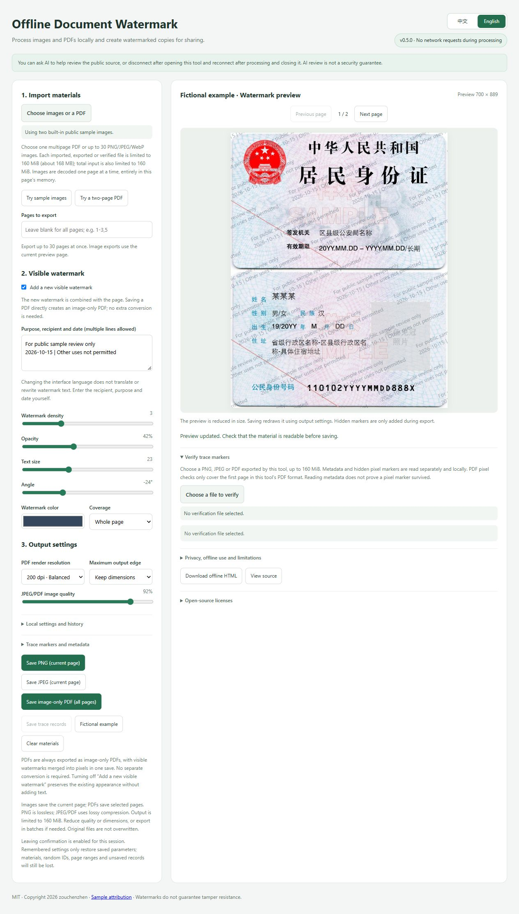
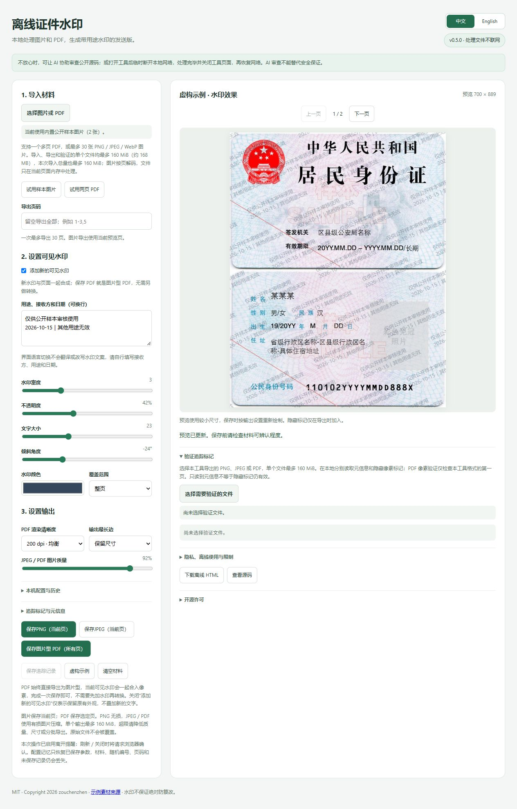
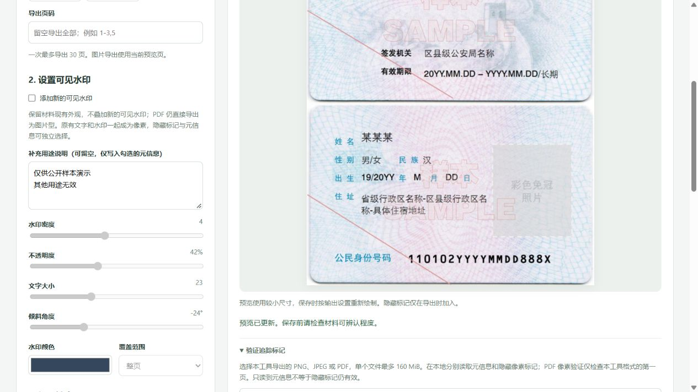
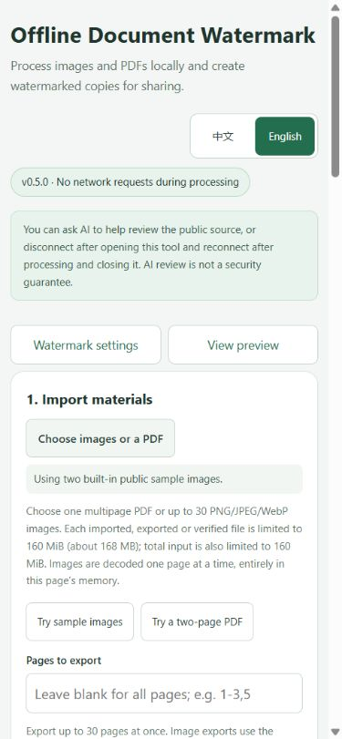

# Offline Document Watermark / 离线证件水印

[中文（默认）](README.md) | [English](README.en.md)

**A single offline HTML file combining multi-page PDFs, purpose-specific watermarks, density and coverage controls, image-only PDF copies, and optional tracing.** Open it online or save it for local offline use, without installing a server or desktop application.

- **Create a copy in one save:** Import a PDF or images, optionally add a visible watermark, hidden ID, and metadata, then save. PDF output is always an image-only multi-page PDF; no separate conversion is needed after adding a watermark.
- **Merge existing watermarks into the page:** Preserve the page's appearance without adding new visible text, combining existing watermarks and page content into pixels to prevent ordinary deletion of a separate PDF text object.
- **Help identify copies:** Optional hidden pixel IDs, metadata, JSON records, and local readback checks help compare copies. Keep your own mapping between IDs and recipients; an ID alone cannot prove who shared a file.

**v0.5.0 · No network requests during file processing.** The online version initially requests the tool page from GitHub Pages. Selected documents are then processed in the current browser without uploading them. PDF parsing libraries, the Worker, fonts, and decoding resources are embedded in the released HTML.

v0.5 adds a Chinese / English interface selector at the top right. The first visit defaults to Chinese; the browser's language does not automatically switch the interface to English. A manually selected language is restored only when remembering settings is enabled; after disabling or clearing settings, a new page starts in Chinese. Switching languages changes interface labels without translating user-entered watermark text. The Chinese documentation remains the default [README](README.md). See this version's [validation record (Chinese)](docs/VALIDATION.md) for the actual test scope.

If you have concerns, review the public source yourself or with AI assistance, or disconnect after the tool has loaded, process and save your files, close the tool page, and then reconnect. **AI review is not a security guarantee.** Remembering settings is enabled by default and stores watermark text and settings in this browser on your computer; you can disable it and clear them. Documents, filenames, trace IDs, and trace records are excluded from these saved settings. Closing the page does not delete saved text. See the [English privacy statement](PRIVACY.en.md).

- **Use online:** https://zouchenzhen.github.io/offline-document-watermark/
- **Download for offline use:** [Releases](https://github.com/zouchenzhen/offline-document-watermark/releases). Download the HTML for the version you want and open it in a browser.
- **Source:** `src/` in this repository. Original application code is MIT-licensed for redistribution, reuse, and contributions.

## When to use it

Identity-document samples, application documents, and screenshots may need a statement such as “Only for [recipient] to process [purpose].” Merging the watermark into the page image prevents a PDF editor from simply selecting and deleting it as separate text.

This project focuses on that document-sharing workflow. It does not replace GIMP's detailed image editing or Acrobat's OCR, forms, digital signatures, and PDF editing. Image watermarking, PDF rasterization, and local processing are not unique to this project; its convenience comes from combining them with density/coverage controls and optional tracing in one HTML file. It cannot guarantee that images are uneditable or automatically identify a person who shared a document.

## Example output

The first example uses an identity-card template prominently marked SAMPLE, not a real identity document. Its public-domain status was checked against official Wikimedia Commons metadata. The second retains a generic 16Personalities screenshot layout, but its type, percentages, character illustration, and type color group were replaced with fictional data and an original neutral graphic. Example assets do not automatically inherit the code's MIT license; see [asset attribution (Chinese)](docs/examples/ATTRIBUTION.md).


Download the [PNG example](docs/examples/id-card-watermarked.png), [JPEG example](docs/examples/id-card-watermarked.jpg), or [two-page image-only PDF example](docs/examples/two-page-watermarked.pdf). They use the public demonstration trace ID `12AB34CD56EF7890`, not anyone's private ID.

## How to use it

These are **actual v0.5.0 Chinese and English interfaces**, tested in local built-in Chromium using the public SAMPLE identity-card template and fictional settings. They contain no real identity documents. The watermark text in each screenshot was entered manually; changing the interface language does not translate it.



<details>
<summary>v0.5 Chinese interface (default)</summary>



</details>

<details>
<summary>Chinese v0.4.2: visible watermark switched off</summary>

Existing watermarks remain, and settings for new visible text are disabled. Hidden marks and metadata can be selected independently; saving a PDF needs no extra conversion step.



</details>

<details>
<summary>Historical Chinese v0.4 settings and verification filenames</summary>

The verification file and trace records are public test examples, with no real recipients. A separate filename display remains after the native file input is cleared. Metadata and hidden-pixel detection are shown separately.


</details>

The narrow layout uses one column and provides shortcuts between settings and preview. These narrow-screen screenshots simulate dimensions in desktop Chromium; they are not a mobile-device certification.

<details>
<summary>v0.5 English narrow-screen interface</summary>



</details>

1. Open the online version, or download the offline HTML and open it in a modern browser such as Chrome or Edge. The initial interface is Chinese; v0.5 adds a Chinese / English selector at the top right. For sensitive files, offline use while disconnected is recommended.
2. Select one PDF or several PNG/JPEG/WebP images. Switch preview pages and, if needed, enter output pages such as `1-3,5`.
3. **Adding a new visible watermark is enabled by default.** Enter the recipient, purpose, and date, then adjust density, opacity, font size, angle, color, and coverage. Switch it off to preserve the existing page and watermark without adding new visible text; there is no second conversion mode to select.
4. Choose the PDF rendering resolution, maximum output dimension, and JPEG/PDF image quality.
5. Select hidden tracing and metadata as needed, and use different IDs for different recipients. Since v0.4, the time prefix is enabled by default; each export combines the current UTC time with a 16-digit hexadecimal ID.
6. Save PNG, JPEG, or an image-only multi-page PDF. Images save the currently previewed page; PDFs save the selected pages. **PDF output is image-only regardless of checkbox settings.** Visible watermarks, hidden IDs, and metadata are processed in the same save according to their individual options.
7. Download the trace records and keep your own recipient-to-ID mapping. Saved settings do not include these records, and closing the page does not preserve trace records you have not downloaded.

The image buttons say “Save PNG (current page)” and “Save JPEG (current page)”. The PDF button defaults to “Save image-only PDF (all pages)”; entering a page range changes it to “Save image-only PDF (selected pages)” and exports that range.

Since v0.4, **remembering settings is enabled by default**. Watermark text and parameters are automatically saved in the current browser on your computer. You can restore them, disable remembering, clear saved settings, or restore one of the latest 10 distinct configurations. Changes are saved after about 0.45 seconds. **Watermark text is also saved**, and may contain a recipient or purpose you entered. Documents, filenames, trace IDs, temporary output page selections, verification results, and trace records are excluded. Disabling remembering clears saved text and history, leaving only the disabled state, which remains disabled after a reload. Storage can differ between browsers, sites, and local files; private browsing or browser policies may prevent saving. See the [English privacy statement](PRIVACY.en.md).

In v0.5, the manually selected interface language joins the existing settings whitelist and uses the same storage key. It is restored when remembering is enabled; after disabling or clearing settings, new pages default to Chinese. Language switching does not translate or rewrite user-entered watermark text.

Selected import and verification filenames remain visible during the current page session but are not saved as settings. Editing parameters, text, a random trace ID, or output pages, or selecting a local file, enables a request for the browser's native confirmation when you subsequently reload, close, or leave the page. **Opening the file picker or selecting a file does not itself trigger a navigation confirmation and does not upload it to a server.** When remembering is enabled, the page attempts to write pending settings before leaving. After reloading, documents, temporary IDs, and page selections must still be selected or entered again. The browser controls the message and whether it appears; some mobile, background-termination, and crash cases cannot be protected by the prompt. Save output files and trace records yourself.

### PDFs are always image-only; the checkbox only controls new visible text

Whether adding a new visible watermark is on or off, saving the image-only PDF renders each page's text, original images, existing watermarks, and any newly selected visible watermark into pixels. One save is enough; adding a watermark and converting to an image-only PDF are not two sequential modes.

If a PDF already has a watermark added in Acrobat or another tool, import it, switch off the new visible watermark, and save to retain the page's appearance without overlaying new visible text. The checkbox also applies to current-page PNG/JPEG output. An optional purpose note can be left empty while it is off and is recorded only when metadata is selected. Hidden IDs and metadata remain independent options. Internal `add` / `flatten` values remain for compatibility with older settings and trace records; they do not represent different PDF output structures.

Image-only PDFs lose searchable/copyable text, OCR layers, forms, and digital signatures. Merging watermarks into pixels prevents ordinary deletion of separate text objects, but someone can still edit, crop, or recognize text from the image. This does not make a file absolutely uneditable or guarantee removal of pre-existing hidden pixel marks.

## Features

| Feature | v0.5.0 |
|---|---|
| Chinese / English interface and documentation | New: top-right selector; initial language is Chinese, without automatic browser-language selection; linked Chinese and English READMEs |
| PNG/JPEG/WebP input | Up to 30 images |
| Multi-page PDF input | Up to 100 pages; encrypted PDFs are not supported |
| Repeated, multi-line purpose watermarks | Supported |
| New visible-watermark checkbox | On by default; off preserves existing appearance without new text; applies to PNG/JPEG/PDF |
| Density, color, angle, font size, and opacity | Adjustable |
| Coverage | Whole page, upper/lower half, or a custom rectangle |
| PNG/JPEG output | Current preview page |
| Image-only multi-page PDF output | Always image-only regardless of options; up to 30 pages per export |
| Resolution and file-size controls | PDF 150/200/300/400 dpi, longest-side limit, JPEG quality |
| Watermark metadata | PNG iTXt, JPEG COM, PDF Info |
| Hidden pixel mark | Experimental, public format, auxiliary identification; see [principles and limits (Chinese)](docs/MARKER.md) |
| Local trace verification and JSON records | Supported; PDF pixel verification checks only the first page |
| Remembered local settings and history | Defaults to saving text and parameters; restore/disable/clear and 10 distinct configurations; excludes documents and trace records |
| Filenames and leave warning | Session-only filename display; asks for native confirmation after edits or file selection when leaving |
| Time-prefixed IDs | On by default; UTC prefix generated on export, consistent across enabled pixel marks/metadata, filenames, and records |
| OCR, source-text editing, forms, digital signatures | Not provided |

## Comparison with similar tools

This project combines **single-HTML offline use, multi-page PDFs, purpose watermarks, density/coverage controls, image-only PDF output, and optional tracing**. The following tools suit different needs. These techniques are not unique to this project, and no evidence establishes an absolute advantage in speed, memory use, or resistance to attacks.

These representative projects were checked against official source, documentation, and licenses visible on **2026-10-14**; this is not an exhaustive list. The third-party tools were not all run in this comparison, and there were no matched device/material benchmarks for speed, memory, or attacks. See [detailed comparisons and fixed source references (Chinese)](docs/ALTERNATIVES.md) for evidence and privacy boundaries.

### Lightweight image and identity-document watermark tools

| Tool / license | Existing strengths | PDF and output | Tradeoffs compared with this project |
|---|---|---|---|
| [sfz](https://github.com/joyqi/sfz) / GPL-3.0-only | Simple single-image workflow with basic repeated-watermark controls | Images → PNG; pixel compositing; no PDF | Can be built locally; the checked official deployment branch includes Google Analytics; no PDF/trace verification |
| [Efrice/watermark](https://github.com/Efrice/watermark) / MIT | Multi-line text, rows/columns, position, spacing, compression; optional saved settings | Images → PNG; multi-page PDF → image-only PDF | Also merges watermarks into pixels; PDF scale is fixed at `1`, without DPI/page-selection/trace controls; requires the static resource directory |
| [Watermarker / 水印姬](https://github.com/TransparentLC/watermarker) / AGPL-3.0 | Text/image/embossed watermarks, blend modes, drag/drop and paste; more styling options | Images → PNG/JPEG/WebP; pixel compositing | No PDF/hidden IDs; some fonts load remotely; its PWA offline claim was not tested here |
| [WaterMark Pro](https://github.com/turkyden/watermark-pro) / MIT | Multiple images, repeated text, batch ZIP downloads | Images → Canvas-encoded PNG/ZIP | This project has no image ZIP output; no PDF workflow was found there, and its defaults include a CDN, Baidu analytics, and Hotjar |

### PDF and general image tools

| Tool / license | Existing strengths | Watermark handling | Tradeoffs compared with this project |
|---|---|---|---|
| [filigrane](https://github.com/Bank-Exit/filigrane) / GPLv3 declared in README | Repeated PDF watermarks, small ID/date text, metadata, and a verification page | Appends text objects to the original PDF, retaining its structure | Not pixel-composited output; the checked version still uses a CDN Worker and is not fully self-contained |
| [pdfcpu](https://github.com/pdfcpu/pdfcpu) / Apache-2.0 | Local CLI, batch processing, text/image/PDF watermarks, many PDF operations | Structured PDF watermarks with add/update/remove APIs | Good for automation and retaining text/vectors; its structured watermarks can be removed and are not this project's pixel-composited copies |
| [Stirling-PDF](https://github.com/Stirling-Tools/Stirling-PDF) / MIT core; proprietary components have separate terms | Self-hosted PDF toolbox: merge, split, convert, OCR, and more | Optional conversion to images after watermarking; full-page rasterization | Broader functionality; web use requires a backend rather than one HTML file; check component capabilities and licenses |
| [GIMP](https://www.gimp.org/) / GPL-3.0-or-later | Detailed offline image editing, layers, selections, many image formats | Imports PDF pages; flattens layers before image export | Better for detailed edits; per-page watermarking needs manual work or scripts; project layers remain editable, so share flattened output |

External-resource or analytics requests do not by themselves mean an image was uploaded. A source review also does not prove that a hosted site always matches its repository. See the detailed comparison for default-configuration evidence and local-use conditions.

**Strengths:** One downloadable HTML combines multi-page PDF input, purpose watermarks, density/coverage controls, image-only PDF output, and trace checks, without installing a server or desktop app. PDF resources are embedded, with no ads, analytics, or remote fonts. PNG/JPEG/PDF metadata, experimental hidden IDs, and export readback are in the same page. Remembered settings include watermark text and can be disabled and cleared; this is not a tool that never writes persistent storage. MIT allows redistribution and integration without requiring derivatives to remain open source.

**Limitations:** The file is about 6 MiB, heavier than a small image-only webpage. PDF rasterization takes computation and memory, may increase file size, and discards searchable text, forms, and digital signatures. Page-count, file-size, and pixel limits apply; encrypted PDFs are unsupported. Image/logo watermarks, WebP output, image batch ZIPs, and professional image editing are not provided. A user reported successful v0.3 use offline on Windows, online in Chrome/Edge, and on a real phone, but device/browser versions are unknown; that does not prove newer features or universal compatibility.

**Protection level:** This project, sfz, and other Canvas tools merge the watermark into pixels so it is not directly removable as separate text or a layer. Under equal image quality and coverage, there is no evidence this project better resists image editing or AI watermark removal. Efrice's image-only PDFs and Stirling's rasterization offer comparable object-deletion protection. Hidden IDs, metadata, and records help compare copies; they do not guarantee resistance to cropping, resizing, or forgery and cannot alone prove who leaked a document.

## Privacy and what “uneditable” actually means

The page, PDF.js, Worker, fonts, and decoder resources are embedded in about 6 MiB. There is no backend, CDN, account, upload endpoint, or runtime package download. The page policy blocks network connections; there is no telemetry or Service Worker. Optional settings memory, introduced in v0.4, uses browser-local storage for watermark text and the latest 10 configurations. Documents and trace records are processed only in the current page session.

GitHub Pages can see ordinary logs for the initial page visit, which is different from processing a selected file locally. The offline file can run while disconnected. Cloud-synced output folders, browser extensions, malware, and recipient actions are outside this tool's control. See the [English privacy statement](PRIVACY.en.md).

For sensitive material, review a fixed source version first. AI can help find problems but does not guarantee privacy or security. To reduce exposure, download and verify the tool, disconnect, process and save to a local folder without automatic cloud sync, close the tool page, and reconnect. Closing the page does not delete remembered text; clear saved settings if needed.

Visible watermarks become image pixels. Output PDFs do not retain separate watermark text or an original unwatermarked image object. This prevents ordinary object deletion, but does not guarantee resistance to cropping, image editing, or AI watermark removal.

The hidden mark uses public, unkeyed mid-frequency DCT projection coding with a trace ID and CRC. The current implementation changes each RGB channel by at most 10 and checks the mark immediately after embedding. JPEG/PDF exports are also verified after actual compression. If the mark cannot be confirmed, downloading stops with a settings-adjustment message rather than silently claiming success. It is still not a cryptographic signature: it can be forged or deliberately removed. Metadata can also be deleted. **Do not treat a detected ID alone as proof of a person's identity, who shared a file, or forensic authenticity.**

When the time prefix introduced in v0.4 is enabled, IDs use `YYYYMMDDTHHmmssZ-16HEX`, for example the fictional public ID `20261014T080000Z-12AB34CD56EF7890`. `Z` means UTC; Beijing time is UTC+8. The time comes from the computer's clock, to the second, when exporting. With hidden marking enabled, the complete ID is embedded in pixels; enabled metadata uses the same ID as the output filename and JSON record. Without the time prefix, the old 16-digit ID is used; readers retain compatibility with old 16HEX / OWM2 files. The prefix is not a trusted timestamp or identity check. Keep a recipient-to-ID mapping to help identify a copy's origin.

Disabling hidden marking means “do not add a new mark,” not “erase an existing pixel mark.” Disabling new visible text preserves the original appearance and does not guarantee removal of older tracing signals; PDF output remains image-only. See [marker principles (Chinese)](docs/MARKER.md) for encoding, readback, and limitations. Reading metadata is not the same as detecting a pixel mark.

The two historical examples detected IDs after JPEG exports at quality 92/80/60; see the [original record](docs/examples/marker-test-results.json). A newer pixel experiment tested OWM2/OWM3 on three public/original images, giving six cases: saving as PNG, actually stripping metadata, and JPEG 92/80 detected all six. JPEG 60 or a 5% brightness/contrast increase detected only 4/6. Flips, 90° rotation, downscaling, and several ordinary crops detected 0/6, while a top-edge crop calculated to align with the encoding detected 6/6. **These counts apply only to the specified samples and parameters, not all compression or editing.** Results come from pixels alone, without filling in an ID from metadata. See [marker documentation (Chinese)](docs/MARKER.md) for full principles, editing parameters, and reproduction steps.

## Build and release

Requires Node.js 22.13 or newer. Dependencies are retained in `vendor/pdfjs/`; building does not require downloading npm packages.

```sh
npm test
npm run test:pdf
npm run build
npm run package
```

Outputs:

- `dist/offline-watermark-v<version>.html`: self-contained HTML that can be opened locally.
- `dist/offline-watermark-v<version>.zip`: reproducible package with the HTML, licenses, and privacy documentation.
- `dist/SHA256SUMS.txt`: checks both HTML and ZIP after packaging; the manifest inside the ZIP checks only HTML to avoid a circular checksum.
- `dist/site/`: static files for GitHub Pages.

The repository includes a Pages workflow that builds and deploys pushes to `main`. Online and offline versions use the same implementation. You can verify the download's SHA-256 with system tools.

## Validation and limits

Pure-function tests cover page ranges, dimension limits, ID formats, hidden-mark embedding/detection/resampling loss, PNG/JPEG metadata, PDF page structure, and density controls. The two demonstration documents were also checked using real PNG/JPEG encoding and decoding, JPEG-compression readback, multi-page PDF.js parsing, and a strict PDF reader.

Browser and mobile interaction evidence is recorded in [docs/VALIDATION.md (Chinese)](docs/VALIDATION.md). Algorithm tests do not establish compatibility with every browser.

See [docs/ACCEPTANCE.md (Chinese)](docs/ACCEPTANCE.md) for the acceptance checklist. **v0.4 passed 80 regression tests**. The actual embedded Chromium candidate passed settings save/new-page restore/history restore/disable/clear, retained filenames, `beforeunload` events, PNG/two-page PDF ID readback, offline JPEG export, and a cold-start PDF Worker. Downloaded offline HTML matched canonical build bytes without runtime text or IDs. Actual PDF.js font, CMYK ICC, JPEG, and JPEG2000 resource checks also passed. On 2026-10-14, a user separately reported successful v0.3 Windows offline HTML, desktop Chrome/Edge online, and real-phone use; this was user-reported manual acceptance with unknown device versions. These newer features did not receive version-specific independent Chrome/Edge, phone, or double-clicked local-HTML testing in v0.4.

v0.4.1 already protected parameter/text edits when leaving. v0.4.2 changed the controls to one visible-watermark checkbox and covered `change` events plus manually edited IDs/pages. **v0.4.2 passed 88 regression tests**. The actual embedded Chromium release page verified native refresh confirmation after parameter-only edits and a single two-page PDF save with new visible watermarks on/off. A strict reader confirmed both outputs had no searchable text. Screenshots, tested scope, and untested devices are listed in [validation records (Chinese)](docs/VALIDATION.md); historical evidence retains its original version context.

**v0.5 passed 102 regression tests.** Actual local built-in Chromium checks covered language switching without changing user text/settings/IDs, English settings restoration in a new page, Chinese defaults after clearing, refresh confirmation after a language-only change, and a narrow English layout without horizontal overflow. Offline cold-start PDF Worker operation, a two-page image-only PDF, current-page PNG/JPEG export, trace verification and byte-identical offline-tool downloads passed. Independent Chrome/Edge, real phones and double-clicked local HTML were not tested for this version; see the complete [validation record (Chinese)](docs/VALIDATION.md).

A user also reported reading “previous information” after flipping, cropping, and reducing image quality, without distinguishing metadata from pixel detection or specifying uniform editing parameters. This is recorded as feedback, not a claim that all those attacks passed.

Preview longest-side resolution is limited to about 1100 pixels; export renders again at the selected settings. Each output page is limited to about 24 million pixels, and very long pages are also subject to browser canvas-size limits. PNG is lossless; JPEG and image-only PDFs use lossy compression. PDF output retains no OCR, editable text, forms, or digital signatures.

## License

Original application code uses **MIT**, see [LICENSE](LICENSE). Commercial use and redistribution are allowed with the copyright and license notice retained. See [LICENSE_NOTES.md (Chinese)](LICENSE_NOTES.md).

PDF.js, fonts, and decoders retain their own licenses; see [THIRD_PARTY_NOTICES.md](THIRD_PARTY_NOTICES.md). Example assets are attributed separately; adding a watermark does not change the underlying artwork's license.

## Community

[LINUX DO — Chinese developer community](https://linux.do/)

This project recognizes and thanks the LINUX DO community for its value in Chinese-language open-source discussion, project sharing, and technical exchange. Unless the community explicitly states otherwise, this is an acknowledgment and link only, not official endorsement.
