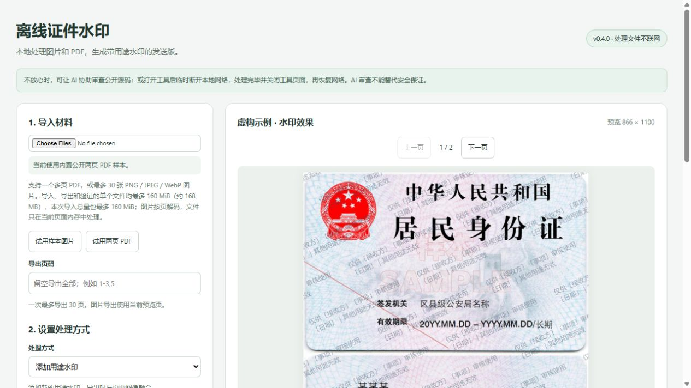
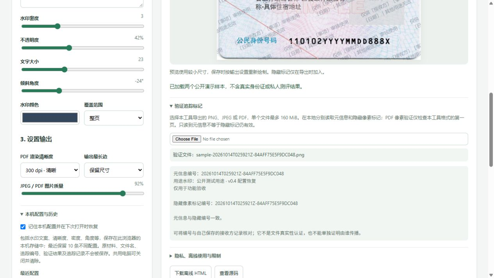
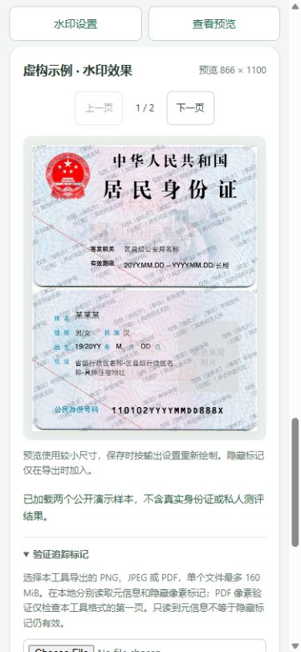

# 离线证件水印 / Offline Document Watermark

**单 HTML 离线，整合多页 PDF、用途水印、密度与覆盖范围、图片型 PDF 发送版和辅助追踪。** 可以在线打开，也可以保存到本地离线使用，无需安装服务器或桌面软件。

- **多页材料一条流程：** 导入 PDF 或图片，调整用途水印的密度、范围和清晰度，导出 PNG/JPEG 或多页图片型 PDF。
- **把已有水印合入页面：** 可不新增可见文字，直接将已有水印和页面内容一起转成像素，减少普通 PDF 对象删除的风险。
- **辅助核对副本：** 可选隐藏像素编号、元信息和 JSON 记录，并读回检查；需要自己保管编号与接收方的对应关系，不能单独证明传播者身份。

**v0.4.1 · 处理文件不联网。** 在线版首次加载会向 GitHub Pages 请求工具网页；之后选入的材料在当前浏览器内处理，不上传。PDF 解析库、Worker、字体和解码资源都内置在发布 HTML 中。

不放心可以先用 AI 辅助审查公开源码，或在工具加载完成后临时断网，处理并保存完成后关闭工具页面，再恢复联网。**AI 审查不等于安全保证。** 默认“记住配置”会把水印文案和设置保存在当前浏览器本机，可关闭并清除；材料、文件名、追踪编号和记录不进入配置存储，关闭页面也不会自动删除已存文案。详见 [隐私说明](PRIVACY.md)。

- **在线使用：** https://zouchenzhen.github.io/offline-document-watermark/
- **下载离线文件：** [Releases](https://github.com/zouchenzhen/offline-document-watermark/releases)，下载对应版本的 HTML 文件后双击打开。
- **源码：** 本仓库 `src/`；原创代码使用 MIT，方便分发、复用和贡献。

## 适合什么场景

身份证样本、申请材料、截图等文件需要写明“仅供某接收方办理某事项使用”，并希望水印与页面图像融合，避免别人用 PDF 编辑器直接选中水印文字删除。

本项目集中处理证件和申请材料的水印发送流程，不替代 GIMP 的精细修图、Acrobat 的 OCR、表单、数字签名和 PDF 编辑功能。基础图片水印、PDF 光栅化和本地处理并非本项目独有；这里的便利在于把这些步骤与密度/范围控制和辅助追踪整合进单文件网页。它不保证绝对不可编辑，也不会自动认定某个接收方泄露了材料。

## 示例结果

示例一使用明确标记 SAMPLE 的身份证模板，不是真实身份证；其公共领域状态已用 Commons 官方元数据核实。示例二保留 16Personalities 截图的通用版式，当前演示已将类型、百分比、人物插画及类型色组改成虚构数据和原创中性图形。示例素材不自动适用代码的 MIT 许可，见 [素材说明](docs/examples/ATTRIBUTION.md)。


可下载 [PNG 示例](docs/examples/id-card-watermarked.png)、[JPEG 示例](docs/examples/id-card-watermarked.jpg) 和 [两页图片型 PDF 示例](docs/examples/two-page-watermarked.pdf)。它们使用公开演示追踪编号 `12AB34CD56EF7890`，不是任何人的私人编号。

## 如何使用

以下是 v0.4 正式在线版的实际操作界面，使用明确标记 SAMPLE 的公开身份证样本，不含真实证件：



<details>
<summary>查看配置记忆与验证文件名界面</summary>

示例验证文件和追踪记录只用于公开功能验收，没有真实接收方。原生选择框清空后，下面的独立文件名仍保持显示；元信息与隐藏像素检测分别列出。



</details>

窄屏布局采用单列，并提供设置与预览的快捷跳转。窄屏截图是桌面 Chromium 的尺寸模拟，不是手机实机认证。

<details>
<summary>查看窄屏预览界面</summary>



</details>

1. 打开在线版，或下载离线 HTML 后在现代 Chrome、Edge 等浏览器中打开。敏感文件建议断网使用离线版。
2. 选择一个 PDF，或多张 PNG/JPEG/WebP 图片。切换预览页；需要时填写导出页码，例如 `1-3,5`。
3. 需要新增用途水印时，输入接收方、用途和日期，调整密度、不透明度、字号、角度、颜色和覆盖区域。已经加好水印的文件可以选择“转为图片型 PDF（保留已有水印）”，不再添加可见文字。
4. 选择 PDF 渲染清晰度、输出最长边、JPEG/PDF 图片质量。
5. 按需要开启隐藏追踪标记和元信息，为不同接收方生成不同编号。v0.4 默认开启时间前缀，每次导出生成当次 UTC 时间与 16 位十六进制编号组合的完整标识。
6. 保存 PNG、JPEG 或多页 PDF。图片只保存当前预览页；PDF 保存选定页。
7. 下载追踪记录，自己保管接收方与编号的对应关系。配置保存不包含这些记录；关闭页面后，本工具不会替你保留未下载的追踪记录。

v0.4 的 **“记住配置”默认开启**：在当前浏览器本机自动保存水印文案和参数，提供恢复、关闭记住、清空已存配置及最近 10 条去重配置历史。调整后约 0.45 秒自动保存。**用途文案也会保存**，可能包含你填写的接收方或用途；材料、文件名、追踪编号、验证内容和追踪记录不进入配置存储。关闭记住后清除已存文案和历史，仅保留关闭状态，刷新后仍关闭。不同浏览器、站点和本地文件的存储范围可能不同；隐私模式或浏览器策略也可能让保存失败。具体边界见 [PRIVACY.md](PRIVACY.md)。

导入和验证所选文件名会在本次页面会话内持续显示，便于核对文件；它们不属于持久配置。页面存在本次会话工作或尚未保存的追踪记录时，尝试离开会请求浏览器原生确认。提示文案和是否弹出由浏览器决定，手机后台关闭等情况可能没有提醒；它不能代替主动保存文件和追踪记录。

### 转为图片型 PDF（保留已有水印）

已经在 Acrobat 等软件加好水印，但担心水印文字被单独删除时，可以导入该 PDF，选择 **“转为图片型 PDF（保留已有水印）”**，然后保存 PDF。工具把每页文字、原图片和已有水印一起绘制成图片，不再添加额外可见水印；输出 PDF 中不保留独立水印文字或无水印原图。

这个模式同样允许保存当前页的 PNG/JPEG，保留当前页面外观；名称强调的是典型的 PDF 发送场景，并不限制图片输出。补充用途说明可留空，仅在选择元信息时记录；隐藏编号仍由相应开关控制。

转成图片型 PDF 会失去可搜索/复制的文字和 OCR 层、表单及数字签名。水印成为像素能避免普通独立文字对象删除，但别人仍可能修图、裁剪或重新识别文字，不能称为绝对不可编辑，也不能保证清除输入中已有的隐藏像素标记。

## 功能

| 功能 | v0.4.1 文案更新；功能沿用 v0.4 |
|---|---|
| PNG/JPEG/WebP 输入 | 支持，最多 30 张 |
| 多页 PDF 输入 | 支持，最多 100 页；加密 PDF 暂不支持 |
| 重复、多行用途水印 | 支持 |
| 转为图片型 PDF（保留已有水印） | 支持，不新增可见水印；也可导出当前页 PNG/JPEG |
| 水印密度、颜色、角度、字号、不透明度 | 支持 |
| 整页、半页、自定义矩形覆盖 | 支持 |
| PNG/JPEG 图片导出 | 支持，当前页 |
| 多页图片型 PDF 导出 | 支持，单次最多 30 页 |
| 清晰度和文件大小控制 | PDF 150/200/300/400 dpi、最长边限制、JPEG 质量 |
| 输出水印元信息 | PNG iTXt、JPEG COM、PDF Info |
| 隐藏像素标记 | 实验性、公开格式、辅助识别；见 [暗水印原理与边界](docs/MARKER.md) |
| 本地追踪验证和 JSON 记录 | 支持；PDF 像素验证仅第一页 |
| 本机记住配置与历史 | 新增：默认自动保存文案和参数，恢复/关闭/清空、最近 10 条去重历史；不存材料或追踪记录 |
| 文件名与离开提醒 | 新增：会话内显示导入/验证文件名，有会话工作时请求浏览器原生离开提醒 |
| 时间前缀追踪编号 | 新增：默认开启，导出时生成 UTC 前缀；用于开启的像素标记/元信息，与文件名和记录一致 |
| OCR、编辑原文、表单、数字签名 | 不提供 |

## 与同类工具比较

本项目的定位是 **单 HTML 离线，整合多页 PDF、用途水印、密度/范围控制、图片型 PDF 输出和辅助追踪**。以下工具各有适用场景；这些技术不是本项目独有，也没有证据表明本项目在速度、内存或抗攻击能力上绝对更好。

以下选取用途接近的代表项目，按 **2026-10-14** 可见的官方源码、文档和许可核查，不是全网穷尽清单。第三方工具未在本次逐一运行，也没有相同设备和素材的速度、内存或抗攻击对测。固定源码链接和隐私边界见 [详细比较与核查依据](docs/ALTERNATIVES.md)。

### 轻量图片和证件水印工具

| 工具 / 许可 | 已有优势 | PDF 与输出方式 | 相比本项目的取舍 |
|---|---|---|---|
| [sfz](https://github.com/joyqi/sfz) / GPL-3.0-only | 适合简单单图流程，基础重复水印参数齐全 | 图片 → PNG；像素合成；无 PDF | 可自行构建；核查的官方发布分支含 Google Analytics；无 PDF/追踪验证 |
| [Efrice/watermark](https://github.com/Efrice/watermark) / MIT | 多行文字、行列数、位置、间距、压缩；可选保存配置 | 图片 → PNG；多页 PDF → 图片型 PDF | 同样支持像素合成；PDF 固定 `scale: 1`，无 DPI、选页或追踪验证；需静态资源目录 |
| [水印姬](https://github.com/TransparentLC/watermarker) / AGPL-3.0 | 文字/图片/浮雕、混合模式、拖拽/粘贴，样式更丰富 | 图片 → PNG/JPEG/WebP；像素合成 | 无 PDF/隐藏标记；部分字体外联，PWA 离线声明未实测 |
| [WaterMark Pro](https://github.com/turkyden/watermark-pro) / MIT | 多图切换、重复文字水印、批量 ZIP 下载 | 图片 → Canvas 编码的 PNG/ZIP | 本项目尚无图片 ZIP；它未见 PDF 流程，默认含 CDN、百度统计及 Hotjar |

### PDF 和通用图像工具

| 工具 / 许可 | 已有优势 | 水印处理方式 | 相比本项目的取舍 |
|---|---|---|---|
| [filigrane](https://github.com/Bank-Exit/filigrane) / README 声明 GPLv3 | PDF 重复水印、小字 ID/日期、元信息及验证页 | 原 PDF 追加文字对象，保留原结构 | 不等同像素发送版；核查版本仍使用 CDN worker，非完整自包含文件 |
| [pdfcpu](https://github.com/pdfcpu/pdfcpu) / Apache-2.0 | 本地命令行，批量处理，文字/图片/PDF 水印和大量 PDF 操作 | PDF 结构水印；提供添加、更新和移除接口 | 适合自动化及保留原文、矢量；其结构水印可被移除，非本项目的像素发送版 |
| [Stirling-PDF](https://github.com/Stirling-Tools/Stirling-PDF) / MIT 核心，专有组件另有条款 | 自托管 PDF 工具箱，合并、拆分、转换、OCR 等 | 可选水印后转图片，支持整页光栅化 | 功能更广；Web 模式需后端处理，非单 HTML；组件能力及许可需核对 |
| [GIMP](https://www.gimp.org/) / GPL-3.0-or-later | 离线桌面精细修图，图层、选区和丰富图像格式 | 导入 PDF 页面，合并图层后导出图片 | 精细编辑更强；分页水印需手工/脚本；工程图层仍可编辑，须发送合成结果 |

外部资源或统计请求不等于图片上传；源码核查也不证明在线站点始终与仓库一致。第三方默认配置的具体证据和本地使用条件见详细比较。

**本项目的优势：** 用一个可直接保存的 HTML 完成多页 PDF 导入、用途水印、密度/范围调整、图片型 PDF 输出和辅助追踪核对，无需安装服务器或桌面软件；发布文件内置 PDF 资源，不含广告、统计或远程字体。PNG/JPEG/PDF 元信息、实验性隐藏编号和导出后读回验证在同一页面内完成。本机配置记忆包含用途文案，可关闭并清除，不能描述为完全不写持久存储。MIT 便于分发和集成，不要求衍生项目继续开源。

**本项目的不足：** 单文件约 6 MiB，比仅处理图片的小网页重；PDF 光栅化耗费计算和内存，输出可能变大，且丢失可搜索文字、表单和数字签名；存在页数、文件大小和像素上限，不支持加密 PDF；尚不能以图片/Logo 作为水印，也未提供 WebP 输出、批量图片 ZIP 或专业修图功能。用户已报告 v0.3 在 Windows 离线、Chrome/Edge 在线和手机实机正常使用，但设备与浏览器版本未知；这不是 v0.4 新功能或全平台兼容性的证明。

**保护程度：** 本项目、sfz 和其他 Canvas 图片工具都把水印合入像素，避免将水印作为独立文字或图层直接删除；同等画质和覆盖条件下，没有证据说明本项目更抗修图或 AI 去水印。Efrice 的图片型 PDF 和 Stirling 的光栅化模式也具有同类对象删除防护。隐藏编号、元信息及追踪记录只辅助核对，不能保证抗裁剪、缩放或伪造，也不能单独证明谁泄露了材料。

## 隐私和“不可篡改”的实际含义

页面、PDF.js、worker、字体和解码资源全部内置，约 6 MiB。无需后端、CDN、账号、上传接口或运行时包下载。页面策略禁止网络连接，不使用遥测或 Service Worker。v0.4 的可选配置记忆使用本机浏览器存储，包含水印文案和最近 10 条配置；材料及追踪记录仍只在本次页面会话内处理。

GitHub Pages 会看到首次网页访问的普通日志；这与选入文件的本地处理不同。离线文件在断网后也能运行。输出目录的云同步、浏览器扩展、恶意软件和收件人行为不受本工具控制。详见 [PRIVACY.md](PRIVACY.md)。

处理敏感材料前，可以先审查固定版本源码；AI 可以帮助找问题，但不能提供隐私或安全保证。进一步控制风险的使用顺序是：下载并核对工具、断网、处理并保存到不自动同步的本地目录、关闭工具页面后再恢复联网。若启用了配置记忆，关闭页面不会删除已存文案，需要自行清空配置。

可见水印成为图片像素，输出 PDF 不保留独立水印文字和无水印原图。这能阻止普通对象删除，但不能保证抵抗裁剪、修图或 AI 去水印。

隐藏标记使用公开、无密钥的中频 DCT 投影编码，包含追踪编号和 CRC。当前实现限制每个 RGB 通道的改动最多为 10，并在嵌入后即时自检；JPEG/PDF 还会对实际压缩字节读回验证。若不能确认标记，停止下载并提示调整设置，不静默声称成功。它仍不是密码学签名；可被伪造或针对性去除。元信息也可被删除。**不得把检出的编号单独当作传播者身份或法证证明。**

v0.4 开启时间前缀时，完整编号格式为 `YYYYMMDDTHHmmssZ-16HEX`，例如公开虚构示例 `20261014T080000Z-12AB34CD56EF7890`。`Z` 表示 UTC；北京时间为 UTC 加 8 小时。时间精确到秒，取本机时钟，在导出时生成；开启隐藏标记时，完整编号真正进入像素；勾选元信息时也写入同一编号，与输出文件名和 JSON 记录一致。关闭时间前缀时继续使用旧的 16 位编号；读取端保留旧 16HEX／OWM2 格式兼容。时间前缀不是可信时间戳，也不验证接收方身份。把不同副本编号与接收方对应表一起保管，才能辅助核对副本来源。

关闭隐藏标记表示“不新增”，不等于删除原文件已有的像素标记。“转为图片型 PDF（保留已有水印）”保留原页面外观，不能保证清除输入文件中的旧追踪信号。暗水印的编码、读回方式和限制见 [原理说明](docs/MARKER.md)，不要把元信息可读等同于像素标记检出。

历史两张示例在 JPEG 质量 92/80/60 导出后检出编号，见 [原测试记录](docs/examples/marker-test-results.json)。新增像素实验用 3 张公开/原创素材分别测试 OWM2/OWM3，共 6 个病例：PNG 另存、确实清除元信息、JPEG 92/80 均检出；JPEG 60、亮度或对比度增加 5% 时仅 4/6 检出；翻转、90°旋转、缩小及几组普通裁剪为 0/6，但计算选取的对齐顶边裁剪为 6/6。**这些是特定样本和参数的计数，不能概括成抗所有压缩或二次编辑。** 结果全部由像素检测得到，不用元信息补编号；完整原理、编辑参数及复现方法见 [暗水印说明](docs/MARKER.md)。

## 构建和发布

需要 Node.js 22.13 或更高版本。依赖已保留在 `vendor/pdfjs/`，构建不需要下载 npm 包。

```sh
npm test
npm run test:pdf
npm run build
npm run package
```

输出：

- `dist/offline-watermark-v<版本>.html`：可双击使用的自包含 HTML。
- `dist/offline-watermark-v<版本>.zip`：可复现打包的 HTML、许可和隐私说明。
- `dist/SHA256SUMS.txt`：打包后同时校验 HTML 和 ZIP；ZIP 内部清单只校验 HTML，避免循环。
- `dist/site/`：可部署到 GitHub Pages 的静态内容。

仓库包含 Pages 工作流；main 分支推送后构建并部署。在线页和离线页使用相同实现。下载后可以用系统工具核对 SHA-256。

## 验证情况与限制

纯函数测试涵盖页码范围、尺寸限制、追踪格式、隐藏标记嵌入/检测/缩放失效、PNG/JPEG 元信息、PDF 页结构和密度控制。另用两张示例检查真实 PNG/JPEG 编解码、JPEG 压缩后检测、PDF.js 多页解析，以及严格 PDF 读取器的输出检查。

浏览器与移动端交互验证记录见 [docs/VALIDATION.md](docs/VALIDATION.md)。不能把算法测试当成所有浏览器兼容性已验证。

当前验收状态见 [docs/ACCEPTANCE.md](docs/ACCEPTANCE.md)。v0.4 的 **80 项回归测试通过**，真实内置 Chromium 候选页通过配置保存/新页面恢复/历史恢复/关闭清空、文件名保持、beforeunload 事件、PNG/两页 PDF 编号读回、断网 JPEG 和冷启动 PDF Worker 检查；实际下载的离线 HTML 与标准构建字节一致，不带运行时文案或编号。实际 PDF.js 字体、CMYK ICC、JPEG/JPEG2000 资源检查也通过。2026-10-14 用户另外报告 v0.3 的 Windows 离线 HTML、桌面 Chrome/Edge 在线及手机实机使用成功；这是用户人工验收报告，设备版本未知。v0.4 新功能仍无独立 Chrome/Edge、手机或直接双击本地 HTML 的本版本实机证据。

用户还报告样本翻转、裁剪和降低清晰度后仍能读取“之前信息”，但未区分元信息与像素标记、也没有统一处理参数。这仅记录为反馈，不宣称这些攻击已全部通过。

预览最长边限制约 1100 像素；保存时按设置重新渲染。每页输出最多约 2400 万像素，特别长的页面也受浏览器画布尺寸限制。PNG 无损；JPEG 和图片型 PDF 有损。PDF 输出不保留 OCR、可编辑文本、表单或数字签名。

## 许可

原创代码使用 **MIT**，见 [LICENSE](LICENSE)。允许商业使用和分发，须保留版权及许可声明。详见 [LICENSE_NOTES.md](LICENSE_NOTES.md)。

PDF.js 和字体/解码资源保留各自许可，见 [THIRD_PARTY_NOTICES.md](THIRD_PARTY_NOTICES.md)。示例图片另行标注，底图不因加入水印而改变许可。
