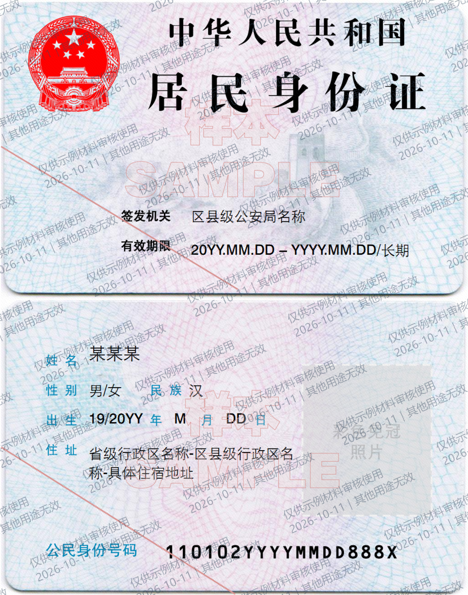
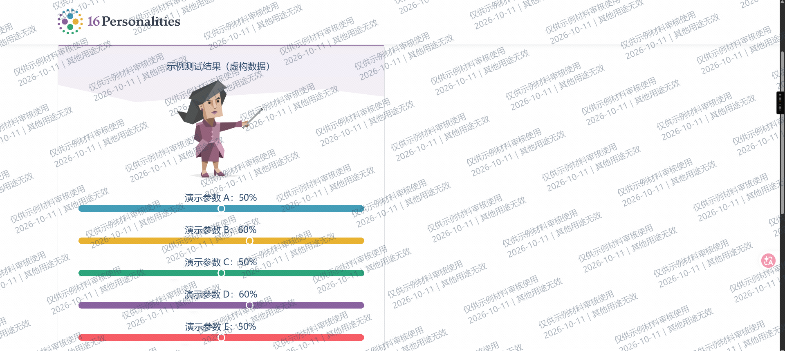

# 离线证件水印 / Offline Document Watermark

在浏览器中给图片和 PDF 添加用途水印，导出适合发送的 PNG、JPEG 或多页图片型 PDF。提供 GitHub Pages 在线版和单文件离线版，处理文件时不上传、不联网。

- **在线使用：** https://zouchenzhen.github.io/offline-document-watermark/
- **下载离线文件：** [Releases](https://github.com/zouchenzhen/offline-document-watermark/releases)，下载 `offline-watermark-v0.2.0.html` 后双击打开。
- **源码：** 本仓库 `src/`；原创代码使用 MIT，方便分发、复用和贡献。

## 适合什么场景

身份证样本、申请材料、截图等文件需要写明“仅供某接收方办理某事项使用”，并希望水印与页面图像融合，避免别人用 PDF 编辑器直接选中水印文字删除。

本项目只做这个工作流程，不替代 GIMP 的精细修图、Acrobat 的 OCR、表单、数字签名和 PDF 编辑功能。它不会保证图片无法修图，也不会自动认定某个接收方泄露了材料。

## 示例结果

示例一使用明确标记 SAMPLE 的身份证模板，不是真实身份证。示例二基于 16Personalities 页面截图，已将类型和百分比替换为虚构演示内容。示例素材不自动适用代码的 MIT 许可，见 [素材说明](docs/examples/ATTRIBUTION.md)。





可下载 [PNG 示例](docs/examples/id-card-watermarked.png)、[JPEG 示例](docs/examples/id-card-watermarked.jpg) 和 [两页图片型 PDF 示例](docs/examples/two-page-watermarked.pdf)。它们使用公开演示追踪编号 `12AB34CD56EF7890`，不是任何人的私人编号。

## 如何使用

1. 打开在线版，或下载离线 HTML 后在现代 Chrome、Edge 等浏览器中打开。敏感文件建议断网使用离线版。
2. 选择一个 PDF，或多张 PNG/JPEG/WebP 图片。切换预览页；需要时填写导出页码，例如 `1-3,5`。
3. 输入接收方、用途和日期。调整水印密度、不透明度、字号、角度、颜色和覆盖区域，让材料仍清晰可辨。
4. 选择 PDF 渲染清晰度、输出最长边、JPEG/PDF 图片质量。
5. 按需要开启隐藏追踪标记和元信息，为不同接收方生成不同编号。
6. 保存 PNG、JPEG 或多页 PDF。图片只保存当前预览页；PDF 保存选定页。
7. 下载追踪记录，自己保管接收方与编号的对应关系。关闭页面后，本工具不会替你保存这些记录。

导入已经加了水印的 PDF 时，本工具会绘制其页面外观；不提取无水印原图。额外可见水印必须填写；如仅需转换已有水印 PDF，可用 Acrobat 的整页图片导出或图像打印功能。

## 功能

| 功能 | v0.2.0 |
|---|---|
| PNG/JPEG/WebP 输入 | 支持，最多 30 张 |
| 多页 PDF 输入 | 支持，最多 100 页；加密 PDF 暂不支持 |
| 重复、多行用途水印 | 支持 |
| 水印密度、颜色、角度、字号、不透明度 | 支持 |
| 整页、半页、自定义矩形覆盖 | 支持 |
| PNG/JPEG 图片导出 | 支持，当前页 |
| 多页图片型 PDF 导出 | 支持，单次最多 30 页 |
| 清晰度和文件大小控制 | PDF 150/200/300/400 dpi、最长边限制、JPEG 质量 |
| 输出水印元信息 | PNG iTXt、JPEG COM、PDF Info |
| 隐藏像素标记 | 实验性、公开格式、辅助识别 |
| 本地追踪验证和 JSON 记录 | 支持；PDF 像素验证仅第一页 |
| OCR、编辑原文、表单、数字签名 | 不提供 |

## 隐私和“不可篡改”的实际含义

页面、PDF.js、worker、字体和解码资源全部内置，约 5.8 MiB。无需后端、CDN、账号、上传接口或运行时包下载。页面策略禁止网络连接，不使用遥测、浏览器持久存储或 Service Worker。

GitHub Pages 会看到首次网页访问的普通日志；这与选入文件的本地处理不同。离线文件在断网后也能运行。输出目录的云同步、浏览器扩展、恶意软件和收件人行为不受本工具控制。详见 [PRIVACY.md](PRIVACY.md)。

可见水印成为图片像素，输出 PDF 不保留独立水印文字和无水印原图。这能阻止普通对象删除，但不能保证抵抗裁剪、修图或 AI 去水印。

隐藏标记使用公开、无密钥的中频 DCT 投影编码，包含追踪编号和 CRC。它不是密码学签名；可被伪造或针对性去除。元信息也可被删除。**不得把检出的编号单独当作传播者身份或法证证明。**

当前两张文档示例在 JPEG 质量 92/80/60 导出后检出了编号；这仅是样本测试结果，不是对所有压缩器、素材或处理方式的保证。缩放测试导致标记丢失。实际结果见 [测试记录](docs/examples/marker-test-results.json)。

## 构建和发布

需要 Node.js 22.13 或更高版本。依赖已保留在 `vendor/pdfjs/`，构建不需要下载 npm 包。

```sh
npm test
npm run build
```

输出：

- `dist/offline-watermark-v0.2.0.html`：可双击使用的自包含 HTML。
- `dist/SHA256SUMS.txt`：离线文件的 SHA-256。
- `dist/site/`：可部署到 GitHub Pages 的静态内容。

仓库包含 Pages 工作流；main 分支推送后构建并部署。在线页和离线页使用相同实现。下载后可以用系统工具核对 SHA-256。

## 验证情况与限制

纯函数测试涵盖页码范围、尺寸限制、追踪格式、隐藏标记嵌入/检测/缩放失效、PNG/JPEG 元信息、PDF 页结构和密度控制。另用两张示例检查真实 PNG/JPEG 编解码、JPEG 压缩后检测、PDF.js 多页解析，以及严格 PDF 读取器的输出检查。

浏览器与移动端交互验证记录见 [docs/VALIDATION.md](docs/VALIDATION.md)。不能把算法测试当成所有浏览器兼容性已验证。

预览最长边限制约 1100 像素；保存时按设置重新渲染。每页输出最多约 2400 万像素，特别长的页面也受浏览器画布尺寸限制。PNG 无损；JPEG 和图片型 PDF 有损。PDF 输出不保留 OCR、可编辑文本、表单或数字签名。

## 许可

原创代码使用 **MIT**，见 [LICENSE](LICENSE)。允许商业使用和分发，须保留版权及许可声明。详见 [LICENSE_NOTES.md](LICENSE_NOTES.md)。

PDF.js 和字体/解码资源保留各自许可，见 [THIRD_PARTY_NOTICES.md](THIRD_PARTY_NOTICES.md)。示例图片另行标注，底图不因加入水印而改变许可。
