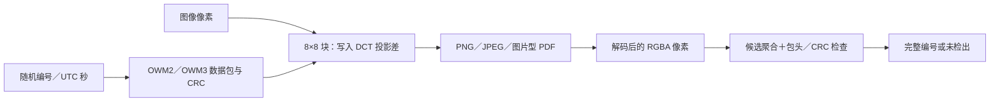

# 隐藏像素标记：原理、二次编辑与实测边界

当前标记适合在部分无损另存、删除元信息和有限压缩后辅助核对副本，**不能保证抵抗一般二次编辑**。翻转、旋转、缩放和裁剪都可能使它失效；本次所测普通几何编辑全部未检出，但另外计算选取的对齐顶边裁剪仍能检出。因此不能把“裁剪必定失效”或“裁剪后必能追踪”当成普遍结论。

## 原理

实现见 [src/core.mjs](../src/core.mjs)。它是公开、无密钥的中频 DCT 投影编码，不是加密、数字签名或法证身份认证。

1. 按原图顺序划分完整的 8×8 像素块。每个像素分别使用 `(R+G+B)/3` 作为灰度近似，并非把整个块平均成一个数；边缘不足 8 像素的部分不参与编码。
2. 比较每块两个中频 DCT 投影 `(2,3)` 与 `(3,2)` 的差值，用正、负差表示一位。重复写入同一编号数据包，让检测可以聚合多次观测。
3. 调整 RGB 像素，使差值达到目标方向。默认目标幅度为 22，每次嵌入每个 RGB 通道改动最多 10，透明度不变。受饱和像素或纹理影响，满足尺寸也不保证可嵌入；嵌入后的实际自检失败就报错。
4. 检测只使用解码后的 RGBA 像素，同时尝试 128/160 位候选。每一位至少需要三个完整块观测，聚合投影差值，再验证包头与 CRC。还保留旧聚合方式以读取历史文件。

| 格式 | 数据包 | 位数 | 返回编号 |
|---|---|---:|---|
| OWM2 | 4 字节包头＋8 字节随机编号＋4 字节 CRC | 128 | 16 位十六进制 |
| OWM3 | 4 字节包头＋4 字节 UTC 秒＋8 字节随机编号＋4 字节 CRC | 160 | `YYYYMMDDTHHmmssZ-16HEX` |

OWM3 时间来自本机时钟，记录导出开始时的 UTC 秒，随机部分保留；时间本身也可以被伪造。CRC 用于检测错误，不是密码学认证。别人可以重写编号或针对性去除信号；检出编号只能与自己保存的接收方记录核对，不能单独证明传播者身份。



元信息是另外存放的可读说明，检测器不会用它补出缺失的像素编号。界面只显示“元信息编号”时，不能据此确认隐藏像素标记仍然存在。

## 本次像素测试

日期为 2026-10-14，实际被测核心为 **v0.4.0**，文件 SHA-256：

`b644fccf6fd4ae4c1e518dbef9876dbc4900eab1acb0a9462ad64213443e3c1b`

这是被测源码的记录；后续仅调整文案或版本号，不应改写本次实验版本与 SHA。核心算法发生变化时应重新测试。

原始参数、尺寸、编码大小、返回编号、失败与筛选记录见 [完整 JSON](examples/marker-robustness-v0.4.json)。使用 Pillow 12.3.0、JPEG 8.0／libjpeg-turbo 3.1.4.1。JPEG 均为 4:2:0、非渐进、`optimize=false`，质量值只对应此编码器设置。

| 材料 | 输入尺寸 | 性质 |
|---|---:|---|
| `id-card-input.png` | 960×1219 | 已公开的 SAMPLE 证件模板 |
| `screenshot-input.png` | 1920×860 | 已公开、脱敏的虚构截图 |
| `synthetic-scan.jpg` | 384×256 | 原创文字、色块和灰阶测试图 |

每张图分别嵌入旧式和时间前缀编号，共 **3 个样本×2 个格式＝6 个病例**。使用固定演示随机编号 `12AB34CD56EF7890`，OWM3 前缀为 `20261014T010807Z`。

输入被转换为不透明白底 RGBA；**没有新增可见文字水印**。这与应用默认“先加可见水印，再嵌隐藏标记”的完整流程不同。它测试隐藏算法及所列编辑条件，不能当作任意可见水印设置、截图软件或所有材料的保证。三个样本的两种格式均通过 PNG 基线读回，无嵌入失败；若有失败，脚本会记录并排除于后续检测率的分母。

PNG 基线实际写入公开虚构 `tool/traceId` 元信息，另存测试确认保留，删除测试确认 `readMetadata(...) === null`。这些读取仅用于检查测试材料是否确实添加／删除了元信息；**下面全部编号检出结果由 RGBA 像素单独计算，不读取元信息来完成检测**。

## 主矩阵

下表的“每样本结果”同时适用于本次该样本的 OWM2 和 OWM3；完整逐格式记录保留在 JSON。数字是本次病例计数，不是总体成功概率。

| 操作 | SAMPLE | 虚构截图 | 原创扫描图 | 合计检出 |
|---|---:|---:|---:|---:|
| PNG 基线读回 | 是 | 是 | 是 | 6/6 |
| 无损 PNG 另存、保留演示元信息 | 是 | 是 | 是 | 6/6 |
| 清除元信息、PNG 像素不变 | 是 | 是 | 是 | 6/6 |
| JPEG 质量 92 | 是 | 是 | 是 | 6/6 |
| JPEG 质量 80 | 是 | 是 | 是 | 6/6 |
| JPEG 质量 60 | 是 | 是 | 否 | 4/6 |
| 亮度×1.05 | 是 | 是 | 否 | 4/6 |
| 亮度×0.95 | 是 | 是 | 是 | 6/6 |
| 对比度×1.05 | 是 | 是 | 否 | 4/6 |
| 对比度×0.95 | 是 | 是 | 是 | 6/6 |
| 水平翻转 | 否 | 否 | 否 | 0/6 |
| 垂直翻转 | 否 | 否 | 否 | 0/6 |
| 逆时针旋转 90°，不插值 | 否 | 否 | 否 | 0/6 |
| Lanczos 缩小为 75% | 否 | 否 | 否 | 0/6 |
| Lanczos 缩小为 50% | 否 | 否 | 否 | 0/6 |
| 四边各裁 3 像素 | 否 | 否 | 否 | 0/6 |
| 四边各裁 8 像素 | 否 | 否 | 否 | 0/6 |
| 保留中心 90% 宽高 | 否 | 否 | 否 | 0/6 |
| 保留中心 75% 宽高 | 否 | 否 | 否 | 0/6 |

尺寸不变的有限压缩可能保留中频关系；亮度／对比度变化若导致像素饱和，也会破坏信号。上述小扫描图在仅加亮或增强对比度 5% 后就失效，不能把“轻微调整”笼统视为安全。

几何变化会改变分块位置、方向或位循环。当前检测没有旋转搜索、尺寸搜索或裁剪位置恢复，所以本次这些几何编辑未检出。**0/6 只说明本次参数和样本，没有证明所有几何编辑一定失效。**

## 独立对齐裁剪病例

另做一个事先由尺寸计算的病例，保留原宽度，只裁顶边整块行。它不计入上面的主矩阵，也未改变算法或为成功结果调参。

令 `C=floor(宽度/8)`，数据包周期 `P=128 或 160`。裁去的最小完整块行数取 `R=P/gcd(P,C)`，顶边像素取 `8R`，使被移除的块数 `RC` 为周期整数倍。预先规定：裁剪不超过图高一半，且剩余完整块仍至少容纳三次数据包；不满足则记为跳过。六个病例都满足此规则。

| 样本 | OWM2 顶边裁剪 | OWM3 顶边裁剪 | 本次像素检出 |
|---|---:|---:|---|
| SAMPLE | 128 像素 | 32 像素 | 两者均是 |
| 虚构截图 | 64 像素 | 16 像素 | 两者均是 |
| 原创扫描图 | 64 像素 | 80 像素 | 两者均是 |

合计 **6/6**，证明某些保留网格和位循环的裁剪仍可能读出像素编号。普通裁剪和对齐裁剪的结果并不矛盾；位置、宽度、剩余重复次数及图像内容都会影响结果。这也说明读出编号不是“文件未被裁剪”的证明。

## 如何复现与使用结果

需要 Node.js 和已安装 Pillow 的 Python，不安装 npm 依赖：

```sh
node scripts/marker-robustness.mjs
# 如果默认 python 不可用：
node scripts/marker-robustness.mjs --python /path/to/python
# 明确需要生成新报告时，指定项目相对路径或绝对路径：
node scripts/marker-robustness.mjs --report docs/examples/new-marker-report.json
```

脚本为每次运行记录当时实际核心 `VERSION`、核心 SHA、素材 SHA、编码器版本和全部编辑参数。默认结果为 Git 忽略的 `test-output/marker-robustness/results.json`，派生图片也写到 `test-output/marker-robustness/`。默认重跑不会覆写已发布的 `examples/marker-robustness-v0.4.json` 历史记录；只有明确传入 `--report` 时才写指定的新报告路径。重跑当前版本不能被说成重新验证了旧源码。脚本不会选择真实证件或用户文件，不联网，不改核心算法。

这次没有测试社交平台重编码、手机实机、截图／打印扫描、复杂修图、多个连续编辑、攻击者主动去除、很多随机编号或同条件竞品对测。一般二次编辑不能保证仍检出；重要文件应在完成所需编辑后再加标记并保存接收方对应记录，再对实际发送版验证。检出失败不等于证明被谁处理过，检出成功也不等于证明文件未变或由谁传播。
